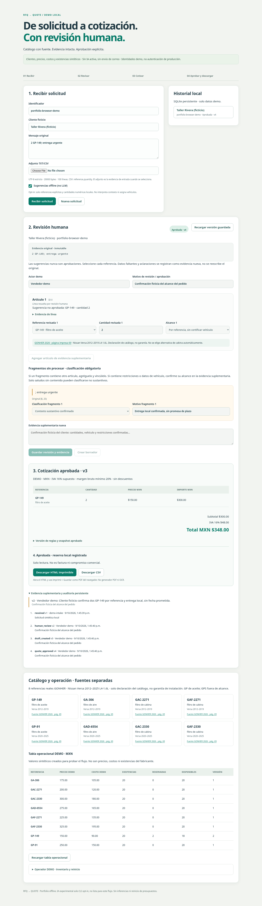

# RFQ-to-Quote

**An offline, human-reviewed quotation workflow for a local automotive-parts portfolio demo.** Spanish React/TypeScript UI, FastAPI, SQLite and deterministic Decimal pricing. No account setup, model API key or cloud service required.

Receive a fictional request → preserve original evidence → resolve each requested part and its context → create a policy-checked draft → explicitly approve the exact version → reserve simulated stock atomically → download a printable quote.



## Quick start

Requirements: Python 3.12+ with `venv`, Node 22.12+ and npm. Verified on Linux with Python 3.14 and Node 22. Initial dependency installation needs package-registry access; the workflow itself operates offline.

```bash
# From this project's directory:
./run-demo.sh
```

Open **http://127.0.0.1:8000/**. The command installs locked Python dependencies, runs `npm ci`, builds the production frontend and starts the same-origin, loopback-only server. Ctrl+C stops it. No Docker requirement. Do not expose the service to a network or use real customer data.

```bash
# Optional configuration, explicitly exported; .env files are not auto-executed:
RFQ_PORT=8001 RFQ_PORTFOLIO_DB=data/my-portfolio-demo.sqlite3 ./run-demo.sh
# Build and test, without starting a persistent server:
./run-demo.sh --verify
```

The default database is `data/portfolio-v1.sqlite3`. Initialization refuses non-portfolio databases rather than migrating older studies. `RFQ_DB` belongs to the historical intake app and is **not** used by the new demo.

## Try the complete flow

1. Leave the prepared fictional customer and request, or paste your own **synthetic** text. Default intake is manual; the numeric/reference parser is an explicit **“Sugerencias offline (no LLM)”** opt-in. TXT/CSV attachment input is also supported.
2. Click **Recibir solicitud**. Select the catalog reference explicitly, confirm quantity, and choose reference-only or vehicle scope. Vehicle scope requires make, model, year and engine backed by the source subset. Unknown references and alternative cabin filters are not automatically substituted.
3. Classify every unresolved fragment. A requested part must link to a reviewed line. Substantive context needs a reason and a new supplemental confirmation; only an exact bounded greeting list can be classified non-substantive. Add the actor, reason and supplemental evidence, then **Guardar revisión y evidencia**. The original never changes.
4. **Crear borrador**. Review MXN amounts, assumed IVA 16%, minimum gross margin 20%, no discounts and the exact quote version. A draft does not reserve stock.
5. Accept the version/rules/catalog and **Aprobar y reservar DEMO**. Availability, prices, costs, margin, inventory version and catalog/rules snapshot are rechecked in the same SQLite transaction as reservation and audit writes.
6. Download **HTML imprimible** or **CSV**. Open the HTML and use the browser's print dialog if you want to save a PDF. There is no server-side PDF generation, OCR or real email delivery.

[Spanish operator guide](docs/GUIA_ES.md) includes attachment format and reproducible stale-price, insufficient-stock and margin scenarios.

## What is real, simulated and experimental?

| Boundary | Implemented scope |
|---|---|
| Manufacturer evidence | Eight real GONHER references and declared Nissan Versa applications from the official 2026 catalog, printed page 69 / PDF page 71. Catalog claim, **not fitment certification**. Manufacturer PDF is linked, not redistributed. |
| Operations | Fictional customers, synthetic MXN prices/costs/stock, demo policy and local simulated reservations. These values are **not manufacturer facts**. |
| Human decisions | Explicit SKU selection, quantity/vehicle confirmation, unknown-context classification, append-only supplemental evidence and version-bound approval. Actor names are demo labels, **not verified production identities**. |
| Offline parser | Literal part-reference shapes and local numeric quantities only. No free-text semantic understanding or inferred part–vehicle relationship. |
| Experimental AI | Separate historical CLI adapters and real recorded synthetic benchmarks. Results were inadequate for this workflow. **Disabled by default; no new inference, budget reset or paid fallback was performed.** |

### Source-backed catalog subset

[Official GONHER catalog](https://gonher.com.mx/wp-content/uploads/2026/04/CATALOGO26_FILTROS.pdf): Nissan Versa, L4-1.6L.

| Declared years | Oil GP subset | Air | Cabin alternatives: explicit selection |
|---|---|---|---|
| 2012–2019 | GP-149 | GA-306 | GAC-2271 / GAF-2271 |
| 2020–2025 | GP-91 | GAD-6554 | GAC-2330 / GAF-2330 |

GPS oil references are outside this curated subset. Absence here does not prove incompatibility; reference-only lookup never certifies a vehicle application. No automatic alternatives, invented fitment or unverified extension to other models/years.

## Architecture and invariants

```text
Spanish React UI ── same-origin JSON / multipart ── FastAPI
       │                                            │
Original text / UTF-8 TXT / bounded CSV          Strict schemas
       │                                            │
Manual intake or opt-in literal parser → Human supplemental review
                                                    │
Immutable source + revisions → Decimal draft + rules/catalog snapshot
                                                    │
Exact-version approval → BEGIN IMMEDIATE → revalidate → reserve + audit
                                                    │
                                      SQLite portfolio-v1 → HTML / CSV
```

- Replaying the same request identifier and exact input returns the existing case. Different content under that identifier returns 409.
- Stale case or inventory versions and stale approval snapshots return 409. Approved cases are read-only. Replaying the exact successful approval has no additional reservation or audit effect.
- Duplicate product lines are summed before stock checks. Concurrent approvals cannot oversell.
- The snapshot binds the customer/request, evidence revision, commercial rules, catalog and inventory prices/costs/version. Money stays in Decimal/string form server-side; IVA is rounded half-up to two decimals.
- No draft until all lines and substantive context have explicit human resolutions. Unsaved UI changes disable draft and approval actions.
- Successful state transitions and inventory changes are persisted with actor, reason and versions. Operational audit survives guarded demo reset. This is not a tamper-proof production audit service.

[Architecture and API](docs/ARCHITECTURE.md) · [Case study and real benchmark limits](docs/CASE_STUDY.md) · [QA evidence](docs/QA_REPORT.md).

## Verification

```bash
./run-demo.sh --verify
.venv/bin/python scripts/http_smoke.py

# Optional real-browser verification, separate dev dependencies:
.venv/bin/python -m pip install -r requirements-dev.txt
export PLAYWRIGHT_BROWSERS_PATH="$PWD/.cache/playwright"
.venv/bin/python -m playwright install chromium
.venv/bin/python scripts/browser_smoke.py
```

The browser script creates its own loopback server and temporary portfolio DB, exercises the actual compiled React UI and real HTTP, downloads both formats, verifies a stale approval and captures six new synthetic screenshots. It does not use the existing demo/history/model ledgers. The HTTP smoke verifies duplicate intake, stale versions/prices, stock/margin blockers, concurrent approval, no double effects and exact persistence after a server restart.

Current verified counts and limitations are in [QA_REPORT](docs/QA_REPORT.md). Component tests use recorded synthetic API fixtures and transport doubles; **they are not the sole end-to-end proof**. CI configuration runs the local-equivalent checks without OAuth or inference; a hosted GitHub Actions run is not claimed before publication.

## Safety and release scope

Input limits: 20,000 Unicode characters / 100 text lines; attachments at most 20,000 bytes, strict UTF-8 (optional BOM), safe TXT/CSV filenames and no control/binary payloads. CSV header is exactly `reference,quantity`, with literal reference tokens and optional positive integer quantity; incomplete quantities still need review. HTTP mutation bodies are capped at 65,536 bytes.

The app uses parameterized SQL, same-origin mutation checks, loopback host allowlisting, CSP, escaped HTML and CSV spreadsheet-formula protection. Downloads use generated UUID filenames, not user paths. All this is **local-demo defense in depth, not production authentication or authorization**. A local operator can change demo inventory and reset the portfolio database with an explicit confirmation. Local database/filesystem administrators can alter its audit.

No SSO, multi-tenancy, ERP, customer delivery, tax-compliance certification, broad natural-language extraction, OCR or validated business ROI. No container execution claim. This project contains agent-authored synthetic fixtures and an engineering demonstration, not evidence of customer adoption or savings.

Historical modules/tests/studies remain locally intact. Private databases, raw model responses, account/catalog metadata, logs, manufacturer PDFs and historical screenshots are excluded by `.gitignore`; the public benchmark summary contains technical results only. Public-checkout regression tests use a sanitized offline technical snapshot when private manifests are absent. [Public release checklist](docs/PUBLIC_RELEASE.md).

MIT license. See [CONTRIBUTING](CONTRIBUTING.md) and [SECURITY](SECURITY.md).
