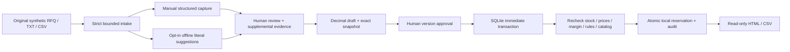

# Architecture and API boundaries

## Running system

- `frontend/src/portfolio-main.tsx` serves the new Spanish workflow. Historical `App.tsx`, its entrypoint and tests remain intact for regression provenance.
- `backend/portfolio.py` contains strict intake/review/commercial schemas and local transactional domain transitions.
- `backend/deterministic.py` is the existing pure, bounded literal parser. The new app calls it only for explicit suggestions; no model adapter is imported by the demo path.
- `backend/quote_export.py` generates escaped local HTML and formula-protected CSV.
- `data/portfolio-v1.sqlite3` is created locally, excluded from publication. Factory `backend.portfolio:application` accepts `RFQ_PORTFOLIO_DB`.

## State and evidence

Request states: `pending → reviewed → draft → approved`. Every received line is pending until explicitly resolved by human review, even if the parser found a literal SKU. Lines become `resolved` after accepted review. The original source includes literal text, initial manual fields, and attachment text/hash/filename when present. Parser results retain Unicode spans and unresolved fragments. Manual selection is never represented as original-message extraction.

A review must cover every original line ID and every fragment ID exactly once. Added lines are allowed for supplemental evidence. Requested-part fragments link to a line; contextual restrictions require explicit resolution and reason. Only a small exact greeting list is permitted for `non_substantive`. All reviews add an immutable supplemental record with actor, reason, version, lines and classifications. Original source and prior supplements are never overwritten. A newer review invalidates an existing draft. Approved cases reject review/draft writes.

The UI distinguishes its unsaved editor from persisted state and disables draft/approval while dirty. The server remains authoritative. Unsaved partial edits are not durably autosaved; a complete review is the save boundary.

## Monetary and inventory policy

Currency MXN, IVA `0.16`, margin floor `0.20`, no discounts. These are explicit demonstration assumptions. Margin is `(price − cost) / price`, evaluated before tax. Prices/costs have two decimals and nonnegative finite values; sale price must be positive. Subtotal uses exact Decimal arithmetic; IVA rounds half-up to cents and total sums subtotal plus rounded IVA.

The draft snapshots customer/request/evidence revision, quote lines with source catalog products, commercial rules and inventory prices/costs/availability/version. Approval supplies the exact quote version and snapshot hash. `BEGIN IMMEDIATE` prevents a read-to-reserve race across SQLite connections/processes. Recomputed snapshot must equal the displayed snapshot. Repeated product IDs aggregate quantities before checking availability. Reservation updates are conditional on stock; every successful reservation and the approved case/audit update commit together or roll back together.

An exact retry of the successful approval, including actor/reason, returns its approved case without another reservation or event. A different retry or stale version returns 409. The approval snapshot is immutable even after operator repricing.

## Persistent tables

| Table | Purpose |
|---|---|
| `portfolio_meta` | Versioned database identity guard |
| `portfolio_cases` | Idempotency fingerprint, immutable original, supplements, revisions, quote and workflow audit |
| `portfolio_inventory` | Synthetic prices/costs, on-hand/reserved stock and optimistic version |
| `portfolio_inventory_audit` | Actor/reason and before/after images for demo edits, reservations and reset |

Initialization rejects databases with foreign tables. Guarded reset requires `RESET PORTFOLIO DEMO`, actor/reason and portfolio-v1 identity. It clears portfolio requests/reservations, restores synthetic defaults, advances inventory versions and preserves operational audit with a reset event. It never targets historical ledgers. This is not a cryptographically protected append-only database: a local administrator can edit it.

## HTTP contract

All mutation JSON rejects unknown fields and coerced types. Original/evidence, amounts, discounts and stock cannot be supplied through approval payloads. Actor/reason need substantive text. Mutation bodies are capped at 65,536 bytes; text at 20,000 Unicode characters / 100 lines; attachment content at 20,000 bytes. TXT/CSV is strict UTF-8 with optional BOM, safe filename, no binary/control content. CSV header exactly `reference,quantity`, at most 99 data rows; reference shape is literal and quantity may be empty pending human review.

| Route | Behavior |
|---|---|
| `GET /api/health` | Loopback demo schema/status and inference-disabled declaration |
| `GET /api/catalog` | Eight source-backed products; no operational pricing |
| `GET /api/requests` / `GET /api/requests/{id}` | Persisted history/detail |
| `POST /api/requests` | JSON `{request_id, customer, message, suggestions?, manual_lines?}`; 201 on create or exact idempotent replay |
| `POST /api/attachments` | Multipart `request_id`, `customer`, `suggestions`, `file`; same domain intake |
| `POST /api/requests/{id}/review` | `{version, actor, reason, supplement, lines, fragments}` |
| `POST /api/requests/{id}/draft` | `{version, actor, reason}`; policy-checked snapshot, no reservation |
| `POST /api/requests/{id}/approve` | `{version, actor, reason, snapshot}`; atomic reservation |
| `GET /api/requests/{id}/download.html` / `.csv` | Approved-only generated attachment download |
| `GET /api/inventory` / `/api/inventory/audit` | Synthetic operational table/audit |
| `POST /api/demo/inventory/{product_id}` | `{version, actor, reason, price, cost, on_hand}`; cannot reduce below reserved quantity |
| `POST /api/demo/reset` | `{confirmation, actor, reason}`; new demo DB only |

404 unknown target; 422 malformed/unresolved/policy-invalid input; 409 conflicting duplicate/stale version/snapshot/read-only state; 413 oversized mutation; 403 cross-origin write; 400 invalid Host. `GET /openapi.json` is the machine-readable schema. The static frontend and assets are same-origin; no production API deployment is supported.

Security controls and unsupported production boundaries are documented in [SECURITY](../SECURITY.md). Full regression tests and independent HTTP/Chromium scripts live alongside the preserved historical suites.
